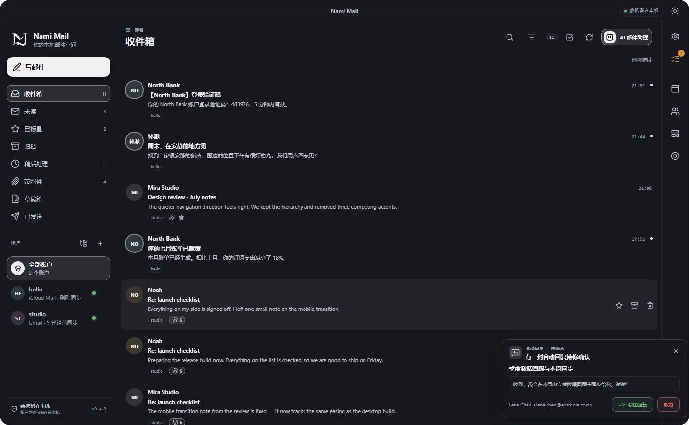
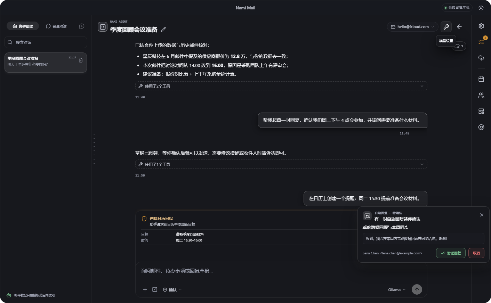

<p align="center">
  <a href="https://qinindexcode.github.io/nami-mail/">
    
  </a>
</p>

<p align="center">
  <strong>本地优先的多账户 Windows 桌面邮件客户端与嵌入式 AI 智能助手</strong><br />
  <strong>Local-first multi-account email client & embedded AI assistant for Windows</strong>
</p>

<p align="center">
  <a href="https://github.com/QinIndexCode/nami-mail/releases"></a>
  <a href="https://github.com/QinIndexCode/nami-mail/releases"></a>
  <a href="https://nodejs.org"></a>
  <a href="https://www.electronjs.org/"></a>
  <a href="LICENSE"></a>
  <a href="https://qinindexcode.github.io/nami-mail/"></a>
</p>

<p align="center">
  <a href="README.zh-CN.md"><b>简体中文说明</b></a> &nbsp;•&nbsp;
  <a href="README.en.md"><b>English Readme</b></a> &nbsp;•&nbsp;
  <a href="https://qinindexcode.github.io/nami-mail/"><b>官网主页 / Website</b></a> &nbsp;•&nbsp;
  <a href="https://github.com/QinIndexCode/nami-mail/releases"><b>下载安装 / Download</b></a>
</p>

---

<p align="center">
  
</p>
<p align="center">
  <em>多账户统一收件箱、文件夹导航与现代设计系统界面 · Unified Inbox & Modern Design System UI</em>
</p>

<p align="center">
  
</p>
<p align="center">
  <em>带来源引用的本地 AI Agent 与多模态附件 · Local-First AI Agent with Verified Citations & Multimodal Attachments</em>
</p>

---

## 核心特性 / Key Features

- **多账户统一收件箱 (Unified Multi-Account Inbox)**  
  集中管理 Gmail、iCloud、Outlook/Hotmail、QQ 邮箱、网易 163、Yahoo、Fastmail 及所有标准 IMAP/SMTP 账户。支持 OAuth 2.0 授权与应用专用密码，首屏秒开。
- **本地优先的 AI Agent (Embedded AI Assistant)**  
  内置 30+ 领域工具（邮件检索、草稿管理、日历调度、通讯录、记忆沉淀与全网搜索）。支持多模态（图片/音频/视频/PDF），严谨溯源引用，关键写操作均由一次性不可变 GUI 确认卡片守卫。
- **全栈本地日历与会议邀请 (Local Calendar & Meeting Invites)**  
  内置月视图日历域；邮件 `.ics` 邀请横幅一键直达腾讯会议/Zoom/飞书/Teams/Meet；ICS 导入导出按 UID 原地去重；事件开始前 15 分钟应用内提醒。
- **端到端本地安全与隐私 (Local-First Privacy & Security)**  
  主密钥受 Windows DPAPI 硬件级保护，敏感数据使用 AES-256-GCM 本地加密落盘；无中心云端托管，凭据与邮件绝不出设备。
- **标准 CLI 与 MCP 扩展生态 (Extensible CLI & MCP Ecosystem)**  
  内置 Windows SID-DACL 安全管道 Broker，提供标准 MCP stdio 协议服务与命令行控制工具，安全接入外部脚本与 IDE 自动化。

---

## 0.5.0 最新动态 / What's New in 0.5.0

- **全栈本地日历与邮件会议邀请**：月视图日程 CRUD、邮件邀请横幅直达腾讯会议/Zoom/飞书/Teams/Meet、ICS 按 UID 原地去重、15分钟提醒。
- **端到端多模态大模型接入**：模型配置支持独立开启图片、音频、视频与 PDF 附件；Composer 动态过滤并展示专属类别 Badge。
- **全套 UI 设计系统与视觉体验重构**：恢复 8px/12px/20px 统一圆角 Token 与同心圆角法则；侧边栏隐藏原生滚动条；全宽 Markdown 表格排版；半透明磨砂骨架屏。
- **账户同步状态实时感知**：侧边栏实时呈现正在同步脉冲状态点，强化文件夹切换与静默轮询的并发时序防护。
- **Agent 鲁棒性与工程解耦**：畸形工具 JSON 自愈重试，上下文预算剪枝与多轮会话自动压缩，超大 App.tsx 拆分为 8 个领域 hooks。

> 详见 [Release Notes](docs/releases/v0.5.0.zh-CN.md) 与 [变更日志 / Changelog](CHANGELOG.zh-CN.md)。

---

## 快速体验 / Quick Start

### 桌面客户端使用 / For Users
日常使用请直接从 [GitHub Releases](https://github.com/QinIndexCode/nami-mail/releases) 下载最新 Windows x64 `.exe` 安装包。

### 开发者本地运行 / For Developers
环境要求：Node.js >= 24.21.0。

```powershell
# 克隆代码仓库
git clone https://github.com/QinIndexCode/nami-mail.git
cd nami-mail

# 安装依赖并构建
npm install
npm run build

# 启动本地服务与前端
npm start

# 或启动本地热重载开发环境
npm run dev
```

---

## 文档导航 / Documentation Directory

### 功能指南 / User Guides
| 主题 / Topic | English | 简体中文 |
| --- | --- | --- |
| 安装与更新指南 / Installation & Updates | [INSTALLING.en.md](docs/INSTALLING.en.md) | [INSTALLING.zh-CN.md](docs/INSTALLING.zh-CN.md) |
| 邮箱接入指南 / Email Provider Setup | [EMAIL-PROVIDERS.en.md](docs/EMAIL-PROVIDERS.en.md) | [EMAIL-PROVIDERS.zh-CN.md](docs/EMAIL-PROVIDERS.zh-CN.md) |
| 日历与邮件邀请 / Calendar & Invites | [CALENDAR.en.md](docs/CALENDAR.en.md) | [CALENDAR.zh-CN.md](docs/CALENDAR.zh-CN.md) |
| 自动回复 / Auto-Reply Pipeline | [AUTO-REPLY.en.md](docs/AUTO-REPLY.en.md) | [AUTO-REPLY.zh-CN.md](docs/AUTO-REPLY.zh-CN.md) |
| 邮件正文翻译 / Message Translation | [TRANSLATION.en.md](docs/TRANSLATION.en.md) | [TRANSLATION.zh-CN.md](docs/TRANSLATION.zh-CN.md) |

### AI Agent 与扩展生态 / Agent & Ecosystem
| 主题 / Topic | English | 简体中文 |
| --- | --- | --- |
| Agent 使用指南 / Agent Usage Guide | [agent/usage.en.md](docs/agent/usage.en.md) | [agent/usage.zh-CN.md](docs/agent/usage.zh-CN.md) |
| Agent 模型提供商 / Model Providers | [agent/providers.en.md](docs/agent/providers.en.md) | [agent/providers.zh-CN.md](docs/agent/providers.zh-CN.md) |
| Agent 工具目录 / Agent Tools Catalog | [agent/tools.en.md](docs/agent/tools.en.md) | [agent/tools.zh-CN.md](docs/agent/tools.zh-CN.md) |
| Agent 架构与边界 / Agent Architecture | [agent/architecture.en.md](docs/agent/architecture.en.md) | [agent/architecture.zh-CN.md](docs/agent/architecture.zh-CN.md) |
| 外部 MCP 接入 / External MCP Servers | [agent/mcp-servers.en.md](docs/agent/mcp-servers.en.md) | [agent/mcp-servers.zh-CN.md](docs/agent/mcp-servers.zh-CN.md) |
| CLI 命令行参考 / CLI Reference | [cli/README.en.md](docs/cli/README.en.md) | [cli/README.zh-CN.md](docs/cli/README.zh-CN.md) |
| MCP Server 协议 / MCP Server Setup | [mcp/README.en.md](docs/mcp/README.en.md) | [mcp/README.zh-CN.md](docs/mcp/README.zh-CN.md) |
| 邮件 RAG 检索 / Mail RAG System | [rag/architecture.en.md](docs/rag/architecture.en.md) | [rag/architecture.zh-CN.md](docs/rag/architecture.zh-CN.md) |

### 安全与工程架构 / Security & Engineering
| 主题 / Topic | English | 简体中文 |
| --- | --- | --- |
| 隐私与本地数据 / Privacy & Local Data | [PRIVACY.en.md](docs/PRIVACY.en.md) | [PRIVACY.zh-CN.md](docs/PRIVACY.zh-CN.md) |
| 架构与信任边界 / System Architecture | [ARCHITECTURE.en.md](docs/ARCHITECTURE.en.md) | [ARCHITECTURE.zh-CN.md](docs/ARCHITECTURE.zh-CN.md) |
| UI 设计系统 / UI Design System | [DESIGN-SYSTEM.en.md](docs/DESIGN-SYSTEM.en.md) | [DESIGN-SYSTEM.zh-CN.md](docs/DESIGN-SYSTEM.zh-CN.md) |
| 本地 API 契约 / Local API Contract | [LOCAL-API.en.md](docs/LOCAL-API.en.md) | [LOCAL-API.zh-CN.md](docs/LOCAL-API.zh-CN.md) |
| 外部 Mail 接口 / External Mail Interface | [EXTERNAL-MAIL-INTERFACE.en.md](docs/EXTERNAL-MAIL-INTERFACE.en.md) | [EXTERNAL-MAIL-INTERFACE.zh-CN.md](docs/EXTERNAL-MAIL-INTERFACE.zh-CN.md) |

### 项目与治理 / Project & Governance
| 主题 / Topic | English | 简体中文 |
| --- | --- | --- |
| 开发说明 / Development Guide | [DEVELOPMENT.en.md](docs/DEVELOPMENT.en.md) | [DEVELOPMENT.zh-CN.md](docs/DEVELOPMENT.zh-CN.md) |
| 贡献指南 / Contributing Guide | [CONTRIBUTING.en.md](CONTRIBUTING.en.md) | [CONTRIBUTING.zh-CN.md](CONTRIBUTING.zh-CN.md) |
| 社区行为准则 / Code of Conduct | [CODE_OF_CONDUCT.en.md](CODE_OF_CONDUCT.en.md) | [CODE_OF_CONDUCT.zh-CN.md](CODE_OF_CONDUCT.zh-CN.md) |
| Windows 发布指南 / Release Guide | [RELEASING.en.md](docs/RELEASING.en.md) | [RELEASING.zh-CN.md](docs/RELEASING.zh-CN.md) |
| 版本发布说明 / Release Notes | [releases/README.en.md](docs/releases/README.en.md) | [releases/README.zh-CN.md](docs/releases/README.zh-CN.md) |
| 变更日志 / Changelog | [CHANGELOG.en.md](CHANGELOG.en.md) | [CHANGELOG.zh-CN.md](CHANGELOG.zh-CN.md) |
| 安全策略 / Security Policy | [SECURITY.en.md](SECURITY.en.md) | [SECURITY.zh-CN.md](SECURITY.zh-CN.md) |
| 支持指南 / Support Guide | [SUPPORT.en.md](SUPPORT.en.md) | [SUPPORT.zh-CN.md](SUPPORT.zh-CN.md) |

---

## 贡献者 / Contributors

感谢以下贡献者 / Thanks to everyone who contributed (bots excluded):

<!-- contributors-start -->
<table>
  <tr>
    <td align="center">
      <a href="https://github.com/QinIndexCode">
        <br />
        <sub><b>QinIndexCode</b></sub>
      </a><br />
      <sub>330 commits</sub>
    </td>
    <td align="center">
      <a href="https://github.com/JIE-jiee">
        <br />
        <sub><b>JIE-jiee</b></sub>
      </a><br />
      <sub>2 commits</sub>
    </td>
  </tr>
</table>
<!-- contributors-end -->
