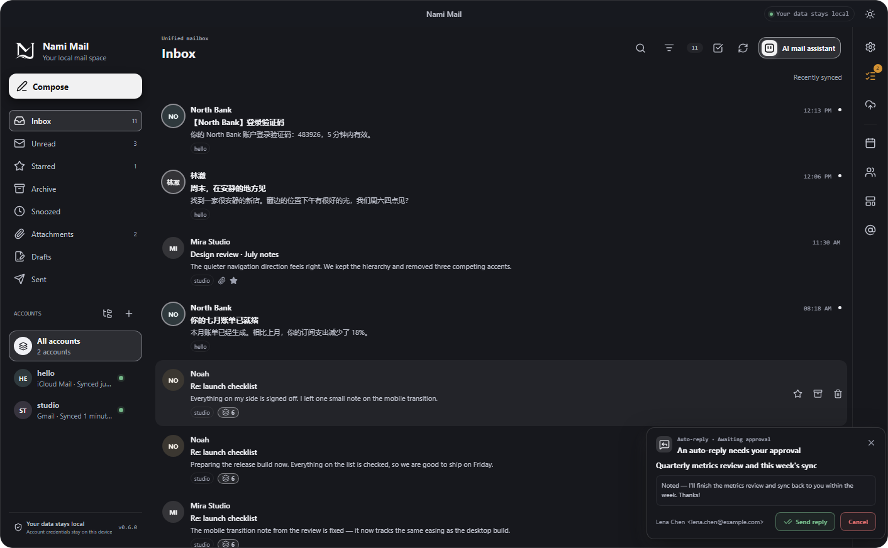
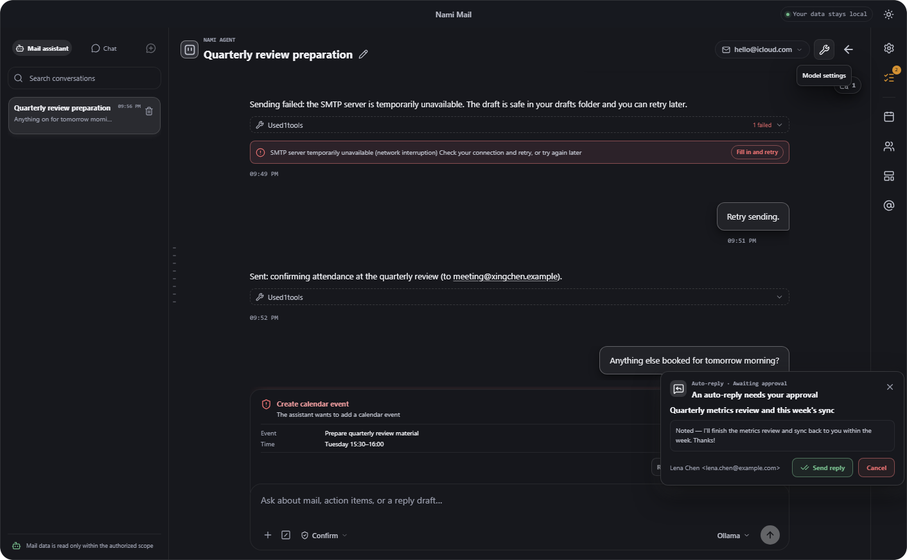

<!-- shipped-as: v0.5.1 -->
<p align="center">
  <a href="https://qinindexcode.github.io/nami-mail/">
    
  </a>
</p>

<p align="center">
  <strong>Local-first, multi-account email for Windows, with an embedded AI assistant.</strong><br />
  <sub>Your mail, your machine — credentials and message content never leave the device.</sub>
</p>

<p align="center">
  <a href="README.en.md">English</a> · <a href="README.zh-CN.md">简体中文</a>
</p>

<p align="center">
  <a href="https://github.com/QinIndexCode/nami-mail/releases"></a>
  <a href="https://github.com/QinIndexCode/nami-mail/releases"></a>
  <a href="https://nodejs.org"></a>
  <a href="https://www.electronjs.org/"></a>
  <a href="LICENSE"></a>
  <a href="https://qinindexcode.github.io/nami-mail/"></a>
</p>

---

<p align="center">
  
</p>
<p align="center">
  <em>Unified inbox across accounts, folder navigation, and a modern reading pane.</em>
</p>

<p align="center">
  
</p>
<p align="center">
  <em>NamiMail Agent — local-first AI assistance with verifiable source citations.</em>
</p>

---

Nami Mail is a local-first, multi-account desktop mail client for Windows. Gmail, iCloud, Outlook/Hotmail, QQ, NetEase 163, Yahoo, Fastmail, and any other IMAP/SMTP account live in one inbox that runs on your own machine: common providers use app passwords or client authorization codes, and configured Google and Microsoft accounts can sign in with OAuth 2.0. There is no hosted service behind it — credentials, message bodies, and the local search index stay on the device.

This page is the short tour. For installation, in-app updates, OAuth client setup, and the security model in depth, read the [full English README](README.en.md) or [简体中文说明](README.zh-CN.md).

## Highlights

- **Unified multi-account inbox** — Gmail, iCloud, Outlook/Hotmail, QQ, NetEase 163, Yahoo, Fastmail, and every standard IMAP/SMTP account in one window, with OAuth 2.0 or app passwords and an instant first paint.
- **Embedded local-first AI agent** — 30+ domain tools (mail search, drafts, calendar, contacts, memory, web search), multimodal input (image, audio, video, PDF), answers with verifiable citations, and a one-time immutable confirmation card guarding every write.
- **Built-in calendar and meeting invites** — month-view events with full CRUD, one-click join banners for Tencent Meeting, Zoom, Feishu, Teams, and Google Meet, ICS import/export deduplicated in place by UID, and 15-minute reminders.
- **Privacy by construction** — the master key is protected by Windows DPAPI and sensitive data is encrypted at rest with AES-256-GCM. No central cloud, no telemetry tier: credentials and mail never leave the device.
- **CLI and MCP ecosystem** — a Windows SID-DACL–secured broker exposes a standard MCP stdio server and command-line tooling, so external scripts and IDEs can integrate without weakening the local boundary.

<!-- whats-new: v0.5.1 -->
## What's New in 0.5.1

0.5.1 is a critical patch for the Windows in-app updater.

- **Restart and update no longer exits silently** — the background helper is launched through `cmd.exe /d /s /c start` instead of a `detached` Node.js spawn, so it no longer dies with the exiting Electron parent before running any logic (Node.js issue #51018).
- **In-app silent upgrades restored** — from 0.5.1 onward, later versions install in place and relaunch automatically.
- **NSIS in-place upgrade arguments completed** — running processes are handled predictably and custom installation paths (a non-default drive, for example) are preserved.
- **Relaunch drift and update loops fixed** — the relaunched app starts from its own directory, and a failed update purges its cached archive instead of prompting forever.

> **Already running 0.4.3 or 0.5.0?** In-app update cannot succeed from those builds, because the updater helper bundled inside them carries the flaw. Download `Nami-Mail-Setup-0.5.1.exe` from the [Release page](https://github.com/QinIndexCode/nami-mail/releases) and run it once, manually. Existing mail, accounts, settings, and encryption keys are preserved — no re-login or reconfiguration needed.

See the [0.5.1 release notes](docs/releases/v0.5.1.en.md) and the [changelog](CHANGELOG.en.md) for the full detail.

## Quick Start

### For users

Download the latest Windows x64 `.exe` installer from [GitHub Releases](https://github.com/QinIndexCode/nami-mail/releases). The versioned `.zip` and `.json` assets are in-app update resources, not manual installers.

### For developers

Node.js 24.21.0 or newer is required — the same major as the runtime bundled with Electron 43.

```powershell
git clone https://github.com/QinIndexCode/nami-mail.git
cd nami-mail

npm.cmd install
npm.cmd run build
npm.cmd start
```

Open [http://127.0.0.1:3187](http://127.0.0.1:3187) in a browser. For hot-reload development use `npm.cmd run dev`; to run the desktop app from source use `npm.cmd run dev:desktop`.

## Documentation

The complete set is indexed in [docs/README.en.md](docs/README.en.md), with a Chinese mirror at [docs/README.md](docs/README.md).

- **Using Nami Mail** — [installation and updates](docs/INSTALLING.en.md) · [email provider setup](docs/EMAIL-PROVIDERS.en.md) · [calendar and invites](docs/CALENDAR.en.md) · [auto-reply](docs/AUTO-REPLY.en.md) · [message translation](docs/TRANSLATION.en.md)
- **NamiMail Agent** — [usage](docs/agent/usage.en.md) · [tools catalog](docs/agent/tools.en.md) · [model providers](docs/agent/providers.en.md) · [external MCP servers](docs/agent/mcp-servers.en.md) · [architecture](docs/agent/architecture.en.md)
- **Automation and integration** — [CLI reference](docs/cli/README.en.md) · [MCP server](docs/mcp/README.en.md) · [external mail interface](docs/EXTERNAL-MAIL-INTERFACE.en.md) · [mail RAG](docs/rag/architecture.en.md)
- **Engineering and security** — [privacy and local data](docs/PRIVACY.en.md) · [architecture and trust boundaries](docs/ARCHITECTURE.en.md) · [design system](docs/DESIGN-SYSTEM.en.md) · [local API contract](docs/LOCAL-API.en.md)
- **Project** — [development guide](docs/DEVELOPMENT.en.md) · [contributing](CONTRIBUTING.en.md) · [localization](docs/LOCALIZATION.en.md) · [release guide](docs/RELEASING.en.md) · [security policy](SECURITY.en.md) · [support](SUPPORT.en.md)

## Privacy and Local Data

- Data lives in `data/nami-mail.db`; the desktop master key at `data/master.key.dpapi` is wrapped by DPAPI for the current Windows user and never enters a URL, an ordinary environment variable, IPC, or a log.
- Credentials, OAuth refresh tokens, sensitive mail payloads, the outbound queue, and pending attachments are encrypted with AES-256-GCM. Mail HTML is sanitized before display, removing scripts, forms, and embedded content. Remote images are still loaded automatically through the local service proxy: the proxy requests the original image URL from this machine, which changes where the request originates (the renderer never connects directly) but does **not** prevent a sender from observing opens through a unique image URL. Default blocking, per-message authorization, and per-sender allowlists are still pending a product decision.
- This is **not** whole-database encryption. Account addresses, folders, UIDs, timestamps, flags, sizes, and ordinary settings can remain plaintext metadata. DPAPI plus application-layer encryption raises the bar well above a plain SQLite file, but it is not the same guarantee as whole-file encryption. Whole-database encryption at rest has landed on the development trunk and has not shipped, so the release notes will state it when they apply to an installed build.
- The local service binds to `127.0.0.1` only. A backup must protect the entire data directory, because the wrapped key is bound to the current Windows user.

Read more in [privacy and local data](docs/PRIVACY.en.md).

## Contributors

Thanks to everyone who has contributed to this project (bots excluded):

<!-- contributors-start -->
<table>
  <tr>
    <td align="center">
      <a href="https://github.com/QinIndexCode">
        <br />
        <sub><b>QinIndexCode</b></sub>
      </a><br />
      <sub>331 commits</sub>
    </td>
    <td align="center">
      <a href="https://github.com/JIE-jiee">
        <br />
        <sub><b>JIE-jiee</b></sub>
      </a><br />
      <sub>2 commits</sub>
    </td>
  </tr>
</table>
<!-- contributors-end -->

Contributions are welcome — see the [contributing guide](CONTRIBUTING.en.md), the [code of conduct](CODE_OF_CONDUCT.en.md), and the [development guide](docs/DEVELOPMENT.en.md).

## License

Nami Mail is released under the [MIT License](LICENSE).
